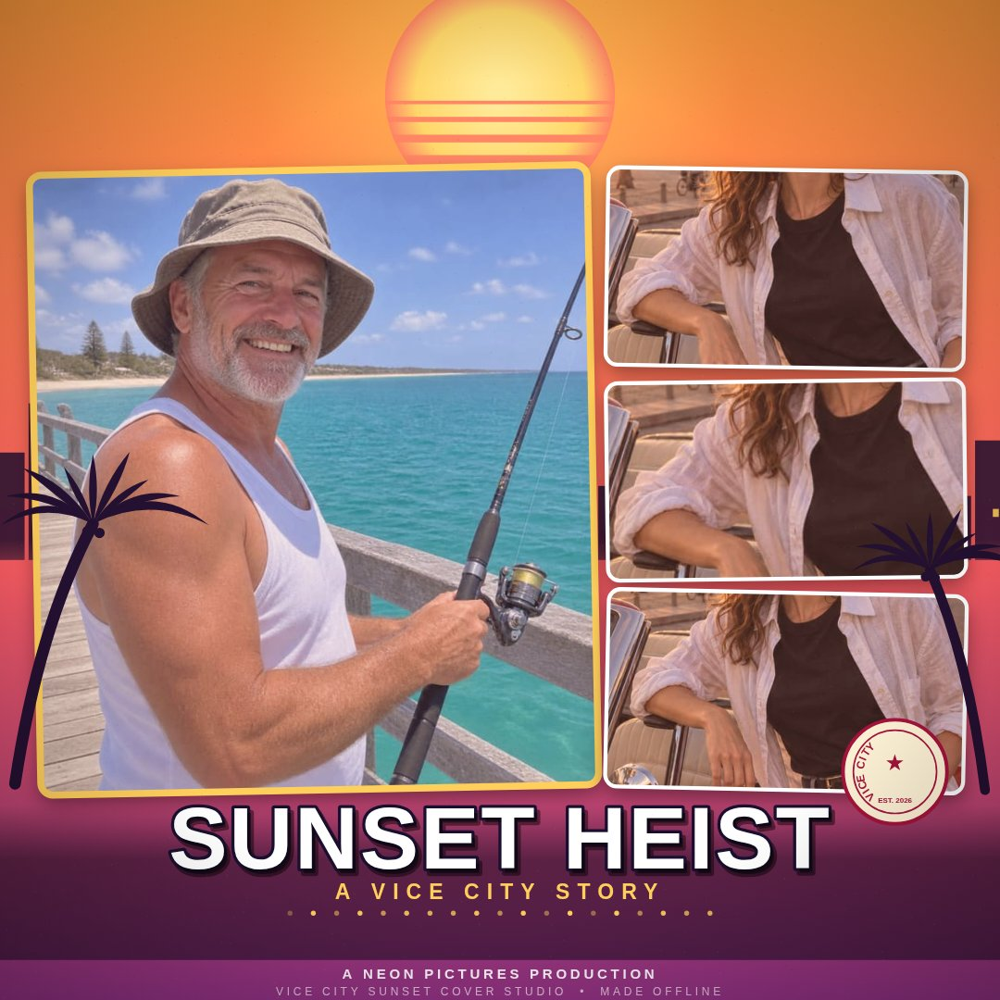

# Vice City Sunset Cover Studio

Turn any photo and caption into GTA-style poster cover art and export it as a PNG
to share. Built by an AI agent for make.fun's
[Make GTA 6 Cover Art](https://make.fun/bounty/gta6-cover-art-01) bounty ($250 in USDC).



## What it does

- **Any photo:** upload your own photos (file picker or drag-and-drop onto the
  preview) or try the two built-in sample photos with one click. Photos are read
  on your own machine and never uploaded anywhere.
- **Multi-panel covers:** four layouts — Hero + 3, Grid 2&times;2, Film strip and
  Full bleed — each panel holding its own photo, tilted slightly like a printed
  poster collage.
- **Crop and position per panel:** click a panel to select it, then drag the photo
  inside it and scroll or slide to zoom; switch between Fill and Fit, put one
  photo in every panel, or shuffle the panels around.
- **Vice City colour grades:** five presets — Sunset, Neon Night, Pastel Day, Vice
  Heat and Gold Rush — each a full poster palette with its own slatted sun,
  skyline, palm silhouettes, grain and vignette, all drawn by the app's own
  canvas code.
- **Caption editing:** main title plus tagline, title size, top or bottom
  placement, and three lettering styles (Block, Neon Script, Retro Slab), all
  styled from system fonts the app draws itself. A circular seal badge and a
  billing block finish the poster.
- **Export PNG:** one click downloads the cover at 1080&times;1080, 1080&times;1350
  or 1920&times;1080. The preview and the PNG are drawn by the same code, so what
  you see is the PNG you get.

## Try it

The app is plain static files under `app/` and works offline in a desktop browser:

```sh
node serve.ts
# then open http://localhost:8080
```

No network requests, no external fonts, images or scripts — everything the app
loads lives under `app/`. The two sample photos were made with an image model
for make.fun and are free to use. All lettering uses system fonts styled by the
app itself: no Rockstar Games logo, artwork or font is used anywhere.

## Handing in

`main.ts` (Node 22, standard library only) copies `app/` and `screenshots/`
from this repository to the output directory and writes `dossier.json` with the
kit's vendored `buildDossier` library. Outside the grader:

```sh
mkdir -p out && MAKEFUN_OUTPUT_DIR=out node main.ts
```

Screenshots were taken by the app's maker with headless Chrome against the
running app, following `shots.json`: the first is an exported cover, the second
is the editor with a photo loaded, and the rest are covers in the other post sizes.
